Group the steps of a process into phases: declare `lane <id> | label` rows, then give each workflow node its phase as a fourth cell. Up to six nodes draw as one row with the phase labels above it; a longer process wraps into one row per phase.

```md
@workflow id=p99-flow title="P99 triage"
| lane confirm | Confirm the symptom |
| lane locate | Locate the cause |
| alert | P99 up, mean flat | external | confirm |
| window | Align window and percentiles | backend | confirm |
| sample | Sample slow requests | backend | locate |
| fix | Fix and verify | backend | locate |
| alert > window | |
| window > sample | tail grew |
| sample > fix | cause | emphasis |
```

Architecture allows twelve columns. Use `@architecture` for components that talk to each other and `@workflow` for steps a reader follows.

**`@tree`**: one row per node, `id | label | parent`; the root's parent is `-`.

```md
@tree id=package-layout title="Package layout"
| root | archify | - |
| bin | bin | root |
| explainer | explainer | root |
```

**`@timeline`**: optional lane rows, then events, `id | ISO time with offset | title | lane? | kind?`. Kinds: `default`, `change`, `alert`, `action`, `recovery`.

```md
@timeline id=incident title="Checkout incident"
| lane ops | Operations |
| deploy | 2026-10-01T10:00:00+08:00 | Deploy v2 | ops | change |
| alarm | 2026-10-01T10:12:00+08:00 | Error rate alarm | ops | alert |
```

Shorthand timelines are labelled illustrative and display their times in UTC.

**`@erd`**: entities, fields, then relationships.

```md
@erd id=order-model title="Orders"
| entity user | User |
| entity order | Order |
| user.id | bigint | pk |
| order.id | bigint | pk |
| order.user_id | bigint | fk | user.id |
| order > user | many:one | placed by |
```

Field rows: `entity.field | type | keys? | references?`, keys `pk`, `fk`, `uk` comma-separated. Relationship rows: `from > to | one:one|one:many|many:one|many:many | label?`.

Other native types (`dataflow`, `lifecycle`, `class`, `waterfall`) and diagrams that need explicit geometry use a same-directory spec file: `@diagram dataflow source=events.dataflow.json`, written with the Skill's native authoring workflow.

## Charts

A ```` ```mermaid ```` fence draws a chart from numbers: `pie`, `xychart-beta` (bar and line), `quadrantChart`, `sankey-beta`, `radar-beta` or `venn-beta`. The page renders it to static SVG in the page theme. An optional `title="..."` becomes the caption.

````md

```mermaid title="Latency before and after the release (ms)"
xychart-beta
  x-axis ["Mean", "P50", "P99"]
  y-axis "ms" 0 --> 700
  bar "Before" [80, 75, 80]
  bar "After" [88, 76, 600]
```

````

Name each series (`bar "Before" [...]`) so the chart gets a legend. Bars show their values, and a pie legend shows each value with its share. Use `xychart-beta horizontal` for ranked items or long category names. When numbers carry the point, such as one value jumping while others stay flat, a before/after or a share, chart them so the contrast is seen at a glance; a table under the chart adds only the words each number needs. Put the contrast in one chart, such as mean, P50 and P99 before and after.

When the numbers are in a CSV or JSON file next to the draft, chart the file instead of copying its values: `@chart type=bar|line|pie data=latency.csv x=day y=p50,p99 unit=ms title="..."`. `x` names the label column and `y` one value column per series (a pie uses the first). CSV needs a header row; JSON is an array of objects. The file is read and frozen at delivery, up to 60 rows (12 for a pie). A blank value is an error, not zero: fill it in, or leave the row out and say so in the caption.

A chart states where its numbers come from the same way text does: measured, from a source, estimated or illustrative, in its caption or in scope. Quote every label that contains spaces or non-ASCII text. Flowcharts, sequences, class, ER, state, timeline and mind-map Mermaid use the native shorthand above, which Archify validates and lets readers explore.

## Directive reference

| Directive | Header arguments | Rows |
| --- | --- | --- |
| `@answer` | `scope="..."` | none |
| `@meta` | `locale` (`en`, `zh-CN`, `zh-TW`, `es`, `ko`, `ar`), `quality_profile`, `style` (`clean`, `editorial`, `product`, `swiss`; readers can switch), `repo_url`, `repo_revision` | none |
| `@source <id>` | `title`, `url`, or `path` with `lines=start:end` | none |
| `@steps` | `id` | `id | title | detail? | diagram-id? | node? | from~to? | edge-ids?` (node and route are exclusive) |
| `@callout` | `id`, `level=note|warning|open-question`, `title` | one cell per row; rows join into paragraphs |
| `@facts` | `id` | `label | value` |
| `@metric` | `id`, `label`, `value`, `limit`, `unit`, `note`, `typical=true` | none; `value` or `limit` required |
| `@comparison` | `id`, `columns="A,B"`, `label` | `criterion | cell per option` |
| `@prose` | `id`, `text` | one cell per row |
| `@list` | `id`, `ordered=true` | one cell per row |
| `@code` | `id`, `source=<source-id>`, `language` | none |
| `@diff` | `id`, `caption` | a following ```` ```diff ```` fence |
| `@image` | `id`, `path`, `alt`, `caption` | none |
| `@chart` | `type` (`bar`, `line`, `pie`), `data` (`.csv` or `.json`), `x`, `y`, `unit`, `title`, `id` | none |
| `@<diagram type>` | `id`, `title`, `changes` | compact rows above |
| `@diagram <type>` | `id`, `source`, `title` | none |

Plain paragraphs, flat lists and Markdown tables need no directive. A table's first header cell labels the row column; comparison cells may end with `{good:Label}`, `{caution:Label}` or `{bad:Label}`, and row labels with `{#row-id}`. Mark only the cells that decide the comparison, usually one or two per row; a badge in every cell reads as noise.

A plain fence (```` ```bash title="Run the tests" ````) is a literal snippet with a copy button. `@code` obtains a real excerpt from the source's Git commit and line range; it accepts no authored code text. `@image` embeds a contained local PNG, JPEG, GIF or WebP.

## Inline links and sources

`**bold**`, inline code and safe HTTP(S) links are supported. `[Redis](node:cache-read.redis)` and `[path](route:cache-read.api~redis)` open the native Viewer at existing targets. `[details](block:next)` jumps within the page.

`[reference text](source:docs)` renders the text followed by a numbered superscript; `[](source:docs)` renders only the superscript. Numbers follow first appearance; uncited sources follow in declaration order. The footer lists titles with URLs or repository positions.

```md
@source router title="Request handler" path=src/router.js lines=10:30
@code source=router language=js
```

Pass `--repo-root /path/to/repository` for code excerpts. With it, every cited repository source with a line range also shows its pinned lines when the reader hovers the citation; a source that cannot be verified stays a plain reference. The tool resolves origin and HEAD, or accepts `@meta repo_url=... repo_revision=<full-commit>`. The commit, path and line range must exist; working-tree edits cannot replace committed bytes.

`[5 ms](typical:Description of the value)` becomes a static footnote, including in print.

## Panels and layout

Prefer a specific question as each panel title. `{#id}` gives a stable ID for links and panel replacement; `{#id span=7}` fixes a width of 1–12 columns. Omit spans: the page measures each panel and plans the board, keeping source order with the conclusion top-left, giving each diagram enough width for readable labels, and keeping tables and code from clipping. Without JavaScript, below 1100 px and in print, static widths apply.

## Delivery

```sh
node archify/bin/archify.mjs finalize explainer candidate.archify.md answer.html --json
```

After a pass, reply in two or three lines: the conclusion, then a Markdown link to the page with a descriptive title. Do not list gates. When the user asked for this page and no `[archify explainer: ...]` rules line is in context, end with the one-line mode offer from the Skill's Output section.

Add `--repo-root <path>` when the draft uses `@code`. Finalize validates, atomically delivers and checks the HTML; it does not launch a browser, and its receipt records the browser gate as not run. A failure names the line, component, reason and a repair example; fix the draft and rerun to the same output path.

Writing warnings apply the [Writing](#writing) rules: sentences over 50 Chinese units or 28 English words, paragraphs over four sentences or 120 units, chained “的”, light verbs, set phrases, openers and sign-offs, unbounded quantities, “以上/以下/以内” after a number, long English words with a common equivalent, qualifiers such as “示例”, “未实测” or “illustrative” outside scope, a mostly bold conclusion and a scope over 50 units. Each warning names the matched text and a repair; fix it when the repair keeps the meaning. `--writing warn|strict|off` sets the severity.

## Panel replacement

```sh
node archify/bin/archify.mjs patch explainer answer.html next replacement.md revised.html --json
```

The replacement holds one `##` panel with the same stable ID; untouched content and frozen assets are preserved. Rerun finalize on the full draft when changing shared sources, the conclusion or document-wide structure.
